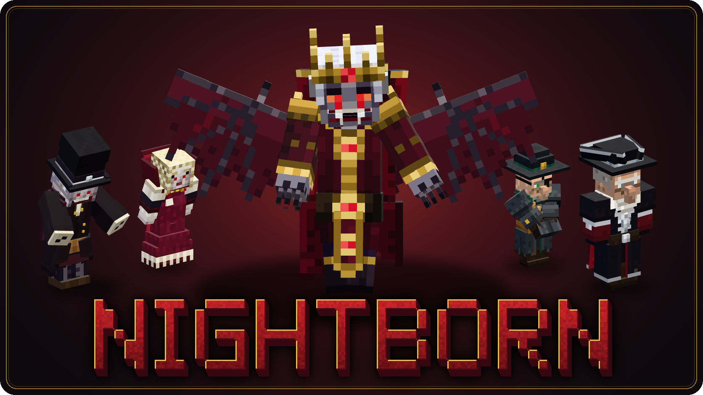
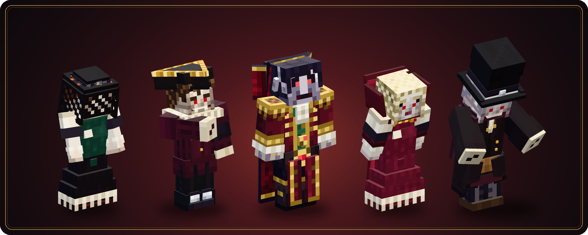
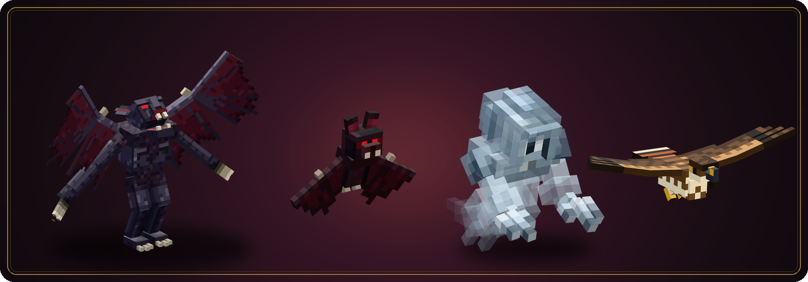
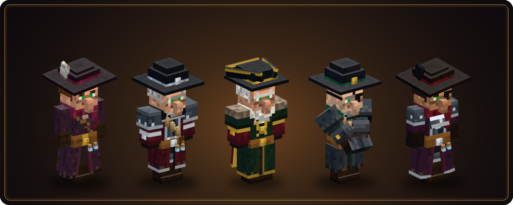
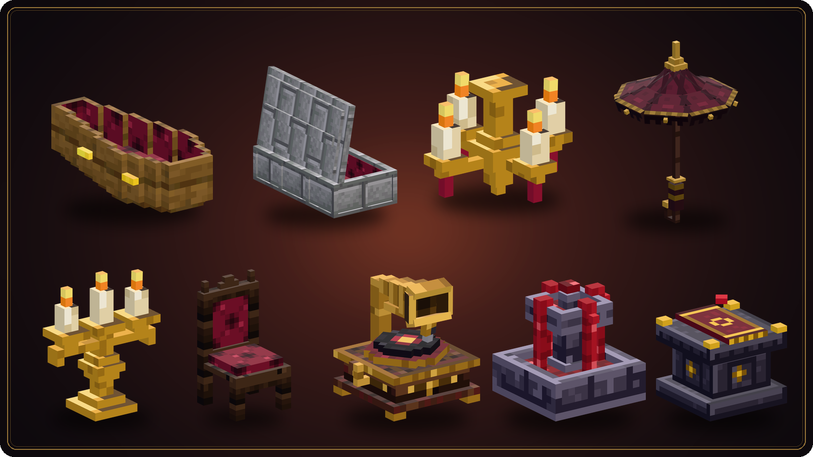
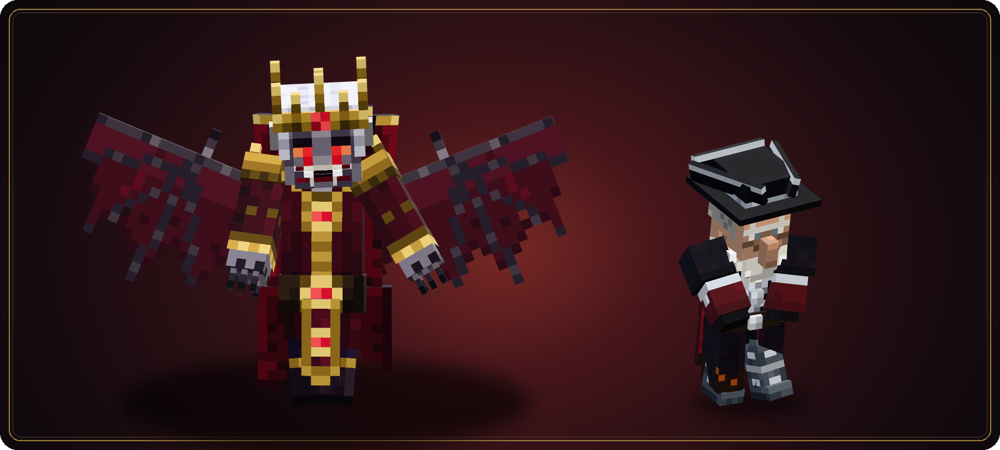

<p align="center">

</p>

<a href="https://modrinth.com/mod/nightborn"></a>
<a href="https://github.com/grabartley/minecraft-nightborn/stargazers"></a>
<a href="LICENSE"></a>
[](https://ko-fi.com/grahambartley)

<p align="center">
<a title="Fabric API" href="https://modrinth.com/mod/fabric-api" target="_blank">

</a>
<a title="GeckoLib" href="https://modrinth.com/mod/geckolib" target="_blank">

</a>
</p>
<p align="center">
Also needs <a href="https://modrinth.com/mod/trinkets">Trinkets</a> and <a href="https://modrinth.com/mod/patchouli">Patchouli</a>.
</p>

# Nightborn

Nightborn adds vampires to Minecraft, and the people who hunt them. Turn and live on blood through the long nights, or
take up stake and silver and go looking for the houses hidden in the dark.

> **Feedback welcome:** Nightborn is new, and we would love to hear how it plays.
> [Open an issue](https://github.com/grabartley/minecraft-nightborn/issues/new) and tell us what you think.

## Rise as a vampire

<p align="center">

</p>

- **Turn.** Drink the old blood kept at the heart of a vampire house, or take a vampire player's turning bite. The
sickness can be cured while it lasts. After that, there is no way back.
- **Feed.** Blood is all you live on now. Sip or drain animals, villagers and other players, bottle it for later, and
finish a badly hurt enemy with a single bite.
- **Fear the sun.** Sleep out the day in a coffin that is yours alone, or walk out under a parasol until it wears
through. Only the sun or a stake can end you. Anything else just brings you down for a while.
- **Choose your blood.** Pick two of three bloodlines. A Noble stares a crowd still, charms villagers and binds thralls.
A Beast takes bat form, pounces on its prey and becomes a great winged terror. An Occult summons a ghostly familiar,
drifts through doors as mist and raises the dead.
- **Grow old.** A fledgling becomes an adult, an elder and at last an ancient, over many nights, with blood drunk and a
deed to prove each stage.
- **Found a house.** Name it, hang its crest on a banner, take in younger vampires, and keep a human familiar to guard
your coffin by day. Then hold it against any member who challenges you for it.

<p align="center">

</p>

## Or hunt them down

<p align="center">

</p>

- **Folklore works.** Stakes, silver, garlic, crucifixes and holy water all do what the old stories say. Coat a blade,
string up garlic, and load a crossbow with stake, silver or holy water bolts.
- **Find the one among you.** A hand mirror shows no vampire, and garlic or a raised crucifix makes one flinch.
- **Join the guild.** Stake a vampire to prove yourself and a Guild Master swears you in. Rise from Initiate to Hunter,
Veteran and Master.
- **Walk two of four paths.** The Faithful pray, bless blades and call down holy light. Slayers dodge, lunge and throw
stakes. Trappers lay snares and bait and net bats out of the air. Seekers read a kill for the vampire behind it and
see through every veil.
- **Take contracts.** Find a hunter camp and its Guild Master sells gear and writes contracts, each with a rough map
of where the house lies.

## A world that notices

Vampires are rare, and each one is someone, with a name, a title and a temper. They live together in households that
wake at dusk, light the candles, talk, quarrel, read and play the gramophone, then sleep out the day in their coffins
with a thrall or two on guard.

- **Five kinds of house.** Crypts under village churches, sealed lairs in deep caves, walled castles in dark woods,
overgrown manors, and a rare pale castle on a mountain top.
- **Villages remember.** Feed where you can be seen and a village learns your face, shuts its doors after dark, hangs
garlic and sends for hunters.
- **So do your enemies.** A named vampire or hunter who gets away from you may come back as your nemesis, stronger each
time.
- **Make it yours.** Coffins, candlelit furniture, a gramophone with gothic music discs, gothic building blocks,
clothing you can dye and enchant, and accessories in eight slots.

<p align="center">

</p>

At night the game's music gives way to organ, harpsichord, strings and choir.

## A boss for each side

<p align="center">

</p>

- **The Eldest.** The oldest vampire of all, with every power of every bloodline. Hunters who gather the relics hidden in
four kinds of house can build an altar and call it with a chalice of blood at night. It fights on foot, then in the air, then
enraged with its eyes blazing. One also waits at the top of every mountain castle.
- **The Grand Inquisitor.** Kill too many hunters and the head of the guild comes for you. A bell tolls nearer each
dusk, then he seals you in a ring of holy light and fights through the Hunt, the Faith and the Pyre until one of you
falls.

Both leave weapons, armour and keepsakes found nowhere else.

## Install

1. Install Fabric Loader, then put Nightborn, [Fabric API](https://modrinth.com/mod/fabric-api),
[GeckoLib](https://modrinth.com/mod/geckolib), [Trinkets](https://modrinth.com/mod/trinkets) and
[Patchouli](https://modrinth.com/mod/patchouli) in your `mods` folder.
2. Load a world. Everyone starts human.
3. Watch for the signs: drained animals, a bat in the trees, villagers who mutter. Then decide which side you are on.

Nightborn works in singleplayer and on servers, on Minecraft `1.21.1`. Its keys are under
`Options > Controls > Key Binds`, in the Nightborn section: `K` opens your skills, `R` `G` `V` `B` `N` use your five
powers, `H` levitates and `J` switches to the turning bite.

## Settings

Almost every number in the mod is a setting, from how much the sun hurts to how often vampire houses appear. Change
them on the settings screen in Mod Menu, or with `/nightborn config`. On a server, only operators can. How much blood
and gore you see is your own choice, and every player can set it.

<details>
<summary><b>Commands</b></summary>

Every `/nightborn` command needs operator permission.

```
/nightborn status
/nightborn config <section> <setting> [value]
/nightborn config reset
/nightborn player <targets> turn
/nightborn player <targets> cure
/nightborn player <targets> swear
/nightborn player <targets> info
/nightborn player <targets> stage [<stage>]
/nightborn player <targets> rank [<rank>]
/nightborn player <targets> skills <vampire|hunter> [points <n>|reset]
/nightborn familiar <targets> release
/nightborn thrall release <thralls>
/nightborn thrall free <players>
/nightborn house disband <players>
```

Any vampire can use `/house` to see their house, and `/house accept`, `decline`, `leave`, `name` and `disband` to
manage it.

</details>

<details>
<summary><b>Works well with</b></summary>

Not needed.

- **[Mod Menu](https://modrinth.com/mod/modmenu)** adds the settings screen to your mods list.

</details>

<details>
<summary><b>Requirements</b></summary>

Minecraft `1.21.1` on Java `21`.

| Mod           | Version            |
|---------------|--------------------|
| Fabric Loader | `>=0.16.5`         |
| Fabric API    | `>=0.116.12+1.21.1` |
| GeckoLib      | `>=4.7`            |
| Trinkets      | `>=3.10.0`         |
| Patchouli     | `>=1.21.1-92`      |

</details>

## Languages

Nightborn is in English, Simplified Chinese (简体中文), German (Deutsch), French (Français), Portuguese (Português do
Brasil), Russian (Русский) and Spanish (Español).

Want to add your language? Copy [`en_us.json`](src/main/resources/assets/nightborn/lang/en_us.json), translate the
text, and open a pull request. Keep the keys, the `%s` placeholders and the `§` codes as they are, and leave command
names and arguments untranslated. Found a mistake in a translation?
[Open an issue](https://github.com/grabartley/minecraft-nightborn/issues/new).

## Credits

How every part of the mod is meant to work is written down in the [product requirements](docs/prd.md).

Nightborn is released under the [MIT License](LICENSE).

The music and many of the sounds are real recordings, each in the public domain or under the licence shown. Every other
asset is original work.

<details>
<summary><b>Music</b></summary>

- Prelude in A minor, BWV 543 (J. S. Bach), by Robert Köbler, [link](https://commons.wikimedia.org/wiki/File:Johann_Sebastian_Bach_Prelude_in_A_minor_BWV_543_Robert_K%C3%B6bler_Silbermann-Organ.mp3), CC BY 1.0
- Goldberg Variations, Variation 25 (J. S. Bach), by Bradley Lehman, [link](https://commons.wikimedia.org/wiki/File:988-v25.lehman1.ogg), CC0 1.0
- String Quartet No. 6, IV. La malinconia (Beethoven), by Musopen String Quartet, [link](https://commons.wikimedia.org/wiki/File:Beethoven_-_String_Quartet_No._6_in_B_flat_major,_Op._18_No._6_-_IV._La_malinconia_(Musopen_String_Quartet).flac), Public domain
- String Quartet No. 6, III. Adagio (Mendelssohn), by Musopen String Quartet, [link](https://commons.wikimedia.org/wiki/File:Mendelssohn_-_String_Quartet_No._6_in_F_minor,_Op._80_-_III._Adagio_(Musopen_String_Quartet).flac), Public domain
- Toccata and Fugue in D minor, BWV 565 (J. S. Bach), by Ashtar Moïra, [link](https://commons.wikimedia.org/wiki/File:Toccata_et_Fugue_BWV565.ogg), Public domain
- Requiem, III. Dies irae (Mozart), by the Vienna Hofmusikkapelle under Josef Krips, [link](https://commons.wikimedia.org/wiki/File:Mozart_-_Requiem_(Krips)_-_III._Dies_ir%C3%A6.flac), Public domain
- Requiem, II. Kyrie (Mozart), by the Vienna Philharmonic and Wiener Singverein under Herbert von Karajan, [link](https://commons.wikimedia.org/wiki/File:W._A._Mozart_-_Requiem_-_2._Kyrie_(Herbert_von_Karajan,_Wiener_Philharmoniker,_Wiener_Singverein,_1960).ogg), Public domain in the EU
- Requiem, V. Rex tremendae (Mozart), by the Vienna Philharmonic and Wiener Singverein under Herbert von Karajan, [link](https://commons.wikimedia.org/wiki/File:W._A._Mozart_-_Requiem_-_5._Rex_tremend%C3%A6_(Herbert_von_Karajan,_Wiener_Philharmoniker,_Wiener_Singverein,_1960).ogg), Public domain in the EU
- Requiem, VII. Confutatis (Mozart), by the Vienna Philharmonic and Wiener Singverein under Herbert von Karajan, [link](https://commons.wikimedia.org/wiki/File:W._A._Mozart_-_Requiem_-_7._Confutatis_(Herbert_von_Karajan,_Wiener_Philharmoniker,_Wiener_Singverein,_1960).ogg), Public domain in the EU
- Requiem, XI. Sanctus (Mozart), by the Vienna Philharmonic and Wiener Singverein under Herbert von Karajan, [link](https://commons.wikimedia.org/wiki/File:W._A._Mozart_-_Requiem_-_11._Sanctus_(Herbert_von_Karajan,_Wiener_Philharmoniker,_Wiener_Singverein,_1960).ogg), Public domain in the EU
- Gregorian choir & organ in Rome, by tullio, [link](https://freesound.org/people/tullio/sounds/780488/), CC0 1.0

</details>

<details>
<summary><b>Sounds</b></summary>

All from Freesound, cut and shaped for the mod.

- 26 Clavando Estaca.wav, by checholio, [link](https://freesound.org/people/checholio/sounds/443631/), CC0 1.0
- 26.07.17- Sleep Foley - Mumbling, by Valerie-Vivegnis, [link](https://freesound.org/people/Valerie-Vivegnis/sounds/862931/), CC BY 4.0
- 27 Clavando Estaca.wav, by checholio, [link](https://freesound.org/people/checholio/sounds/443630/), CC0 1.0
- 28 Clavando Estaca.wav, by checholio, [link](https://freesound.org/people/checholio/sounds/443629/), CC0 1.0
- AMB_Wind_Howling_empty Church close to window, by Tonmeister88, [link](https://freesound.org/people/Tonmeister88/sounds/557380/), CC0 1.0
- ambience cave7, by fonografico, [link](https://freesound.org/people/fonografico/sounds/636125/), CC0 1.0
- Angry frustrated and disappointed - Male - Various Sounds., by khenshom, [link](https://freesound.org/people/khenshom/sounds/527737/), CC0 1.0
- Apple Biting and Chewing.wav, by RoofDog, [link](https://freesound.org/people/RoofDog/sounds/79243/), CC0 1.0
- AppleBite.wav, by MadManJimJam, [link](https://freesound.org/people/MadManJimJam/sounds/426715/), CC0 1.0
- Bats squeak in the small cave, by Selector, [link](https://freesound.org/people/Selector/sounds/404152/), CC0 1.0
- BellChurch, by www.bonson.ca, [link](https://freesound.org/people/www.bonson.ca/sounds/12651/), CC BY 4.0
- BELLLrg_Herz-Jesu Church Single Small Bell Close_GILLE_GRAZ_ZoomH3_Binaural3o.wav, by JakobGille, [link](https://freesound.org/people/JakobGille/sounds/693774/), CC0 1.0
- Bells - Tocsin, by Vrymaa, [link](https://freesound.org/people/Vrymaa/sounds/770122/), CC0 1.0
- Bells of the Church of St. Wolfgang - Glocken der Kirche St. Wolfgang am Wolfgangsee, by Marschal, [link](https://freesound.org/people/Marschal/sounds/785252/), CC0 1.0
- chain light solid rattle various rough and soft, by kyles, [link](https://freesound.org/people/kyles/sounds/637356/), CC0 1.0
- clear throat13.wav, by Reitanna, [link](https://freesound.org/people/Reitanna/sounds/343910/), CC0 1.0
- clear throat4.wav, by Reitanna, [link](https://freesound.org/people/Reitanna/sounds/323692/), CC0 1.0
- coffee slurp 5, by benkenart, [link](https://freesound.org/people/benkenart/sounds/568043/), CC0 1.0
- Crackling candle, by carlopatrao, [link](https://freesound.org/people/carlopatrao/sounds/628432/), CC BY 4.0
- Creaking in Room 6, by Greg_Surr, [link](https://freesound.org/people/Greg_Surr/sounds/590169/), CC0 1.0
- Cry- Pain- woman, by Valerie-Vivegnis, [link](https://freesound.org/people/Valerie-Vivegnis/sounds/767947/), CC BY 4.0
- Death Knell - Totenglocke, by donStevo, [link](https://freesound.org/people/donStevo/sounds/553299/), CC0 1.0
- death2, by womb_affliction, [link](https://freesound.org/people/womb_affliction/sounds/429196/), CC BY 4.0
- Dona nobis pacem.wav, by itinerantmonk108, [link](https://freesound.org/people/itinerantmonk108/sounds/553797/), CC0 1.0
- drawer cabinet chest open close creak squeak mechanical friction wood foley variations close-up zoom-h5, by dimapain, [link](https://freesound.org/people/dimapain/sounds/864781/), CC0 1.0
- Drink, gulp, and sigh, by fthgurdy, [link](https://freesound.org/people/fthgurdy/sounds/528182/), CC0 1.0
- Drinking.wav, by craigglenday, [link](https://freesound.org/people/craigglenday/sounds/517173/), CC0 1.0
- Dry leaves rustle and break, by lreeve, [link](https://freesound.org/people/lreeve/sounds/862894/), CC0 1.0
- Fast food soda with ice, sip slurp straw.wav, by SpliceSound, [link](https://freesound.org/people/SpliceSound/sounds/188191/), CC0 1.0
- Female breathing / Respiracion femenina, by GillianHonn, [link](https://freesound.org/people/GillianHonn/sounds/850672/), CC0 1.0
- FemaleGrunt1.wav, by BranndyBottle, [link](https://freesound.org/people/BranndyBottle/sounds/464675/), CC0 1.0
- Flapping wings of a bird, by Raclure, [link](https://freesound.org/people/Raclure/sounds/405552/), CC0 1.0
- Foley_Clothes_Jacket_Whoosh_Sequence_Stereo.wav, by Nox_Sound, [link](https://freesound.org/people/Nox_Sound/sounds/495390/), CC0 1.0
- formula_baptizandi.wav, by cormi, [link](https://freesound.org/people/cormi/sounds/128513/), CC0 1.0
- Four_Voices_Whispering_6_wEcho.wav, by geoneo0, [link](https://freesound.org/people/geoneo0/sounds/193818/), CC0 1.0
- Groans from a Man, by FuzzyTuesday, [link](https://freesound.org/people/FuzzyTuesday/sounds/730386/), CC0 1.0
- Grunts_Various Male.mp3, by SnowFightStudios, [link](https://freesound.org/people/SnowFightStudios/sounds/643670/), CC0 1.0
- Hand Bell.wav, by WebbFilmsUK, [link](https://freesound.org/people/WebbFilmsUK/sounds/200318/), CC0 1.0
- HeroineDiesDramatically, by Soundjougi, [link](https://freesound.org/people/Soundjougi/sounds/826719/), CC0 1.0
- Human_groan_female 01.mp3, by Vaporpup, [link](https://freesound.org/people/Vaporpup/sounds/570116/), CC0 1.0
- hunting-horn-bass.wav, by nanoPlink, [link](https://freesound.org/people/nanoPlink/sounds/148645/), CC0 1.0
- Indistinct deep male mumble, by dynamique, [link](https://freesound.org/people/dynamique/sounds/536967/), CC0 1.0
- Knife Stab Melon.wav, by jawbutch, [link](https://freesound.org/people/jawbutch/sounds/344404/), CC0 1.0
- Knife Stab Pull.wav, by neilsher, [link](https://freesound.org/people/neilsher/sounds/411742/), CC0 1.0
- Male breathing, by zogmachine, [link](https://freesound.org/people/zogmachine/sounds/202606/), CC0 1.0
- Male Grunts, by Kodack, [link](https://freesound.org/people/Kodack/sounds/256603/), CC0 1.0
- Male Whisper, by IENBA, [link](https://freesound.org/people/IENBA/sounds/850703/), CC0 1.0
- MaleDeathSound13.wav, by Blankened, [link](https://freesound.org/people/Blankened/sounds/577032/), CC0 1.0
- ManGroaning, by dvdiso, [link](https://freesound.org/people/dvdiso/sounds/786286/), CC0 1.0
- md4trk8, by alienistcog, [link](https://freesound.org/people/alienistcog/sounds/123658/), CC0 1.0
- Metal hit_1(sword, hammer, blacksmith).wav, by o_ciz, [link](https://freesound.org/people/o_ciz/sounds/475416/), CC0 1.0
- Mice Sqeak, by adamamazing, [link](https://freesound.org/people/adamamazing/sounds/557703/), CC0 1.0
- Opening a creaking door, by Ryding, [link](https://freesound.org/people/Ryding/sounds/125957/), CC0 1.0
- rat-squeak, by toefur, [link](https://freesound.org/people/toefur/sounds/288941/), CC0 1.0
- Retching, by mefrancis13, [link](https://freesound.org/people/mefrancis13/sounds/117605/), CC0 1.0
- SFX-Door Open, Wind Howl, by soundandmelodies, [link](https://freesound.org/people/soundandmelodies/sounds/776152/), CC0 1.0
- short pigeon wing flap, by zouzmusic, [link](https://freesound.org/people/zouzmusic/sounds/414671/), CC0 1.0
- SHORT-SIZZLE-FRY-PAN.wav, by newagesoup, [link](https://freesound.org/people/newagesoup/sounds/351406/), CC0 1.0
- snakey woman.wav, by poots, [link](https://freesound.org/people/poots/sounds/71031/), CC BY 4.0
- Steel Spring Bear Trap, by fractionalist, [link](https://freesound.org/people/fractionalist/sounds/644245/), CC0 1.0
- Stimme - Zischen, by BockelSound, [link](https://freesound.org/people/BockelSound/sounds/489376/), CC BY 4.0
- Stone Scrape, by alegemaate, [link](https://freesound.org/people/alegemaate/sounds/667284/), CC0 1.0
- stone_slab3, by NistuGgner, [link](https://freesound.org/people/NistuGgner/sounds/700537/), CC0 1.0
- Sword_Clash (7).wav, by JohnBuhr, [link](https://freesound.org/people/JohnBuhr/sounds/326868/), CC0 1.0
- Water Dripping in Cave, by Sclolex, [link](https://freesound.org/people/Sclolex/sounds/177958/), CC0 1.0
- Water Poured onto a Burning Fireplace - Hissing Steam and Sizzling Embers, by bassimat, [link](https://freesound.org/people/bassimat/sounds/870180/), CC0 1.0
- Well Lid.WAV, by cribbler, [link](https://freesound.org/people/cribbler/sounds/367955/), CC0 1.0
- whispering male, by germanio, [link](https://freesound.org/people/germanio/sounds/369913/), CC0 1.0
- Woman Dying With Echo Reverb, by Soundjougi, [link](https://freesound.org/people/Soundjougi/sounds/825978/), CC0 1.0
- woman fighting.wav, by drotzruhn, [link](https://freesound.org/people/drotzruhn/sounds/405328/), CC BY 4.0
- Woman vomiting into toilet.wav, by LOVEBURD, [link](https://freesound.org/people/LOVEBURD/sounds/343385/), CC0 1.0
- Woman, female, inhale, exhale, sigh, breathing.wav, by SpliceSound, [link](https://freesound.org/people/SpliceSound/sounds/218311/), CC0 1.0
- wooden-door-creak-slow, by alienistcog, [link](https://freesound.org/people/alienistcog/sounds/125310/), CC0 1.0
- Wooden_Door_Squeak_04, by BlondPanda, [link](https://freesound.org/people/BlondPanda/sounds/778462/), CC0 1.0

</details>

If you enjoy Nightborn, a star on GitHub or a coffee on Ko-fi helps a lot.

<a href="https://ko-fi.com/grahambartley" rel="noopener nofollow ugc" target="_blank">

</a>
